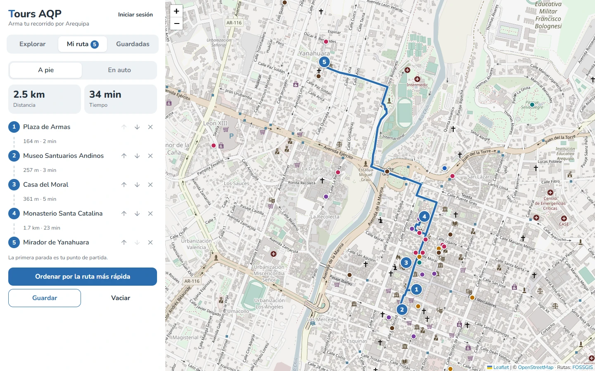
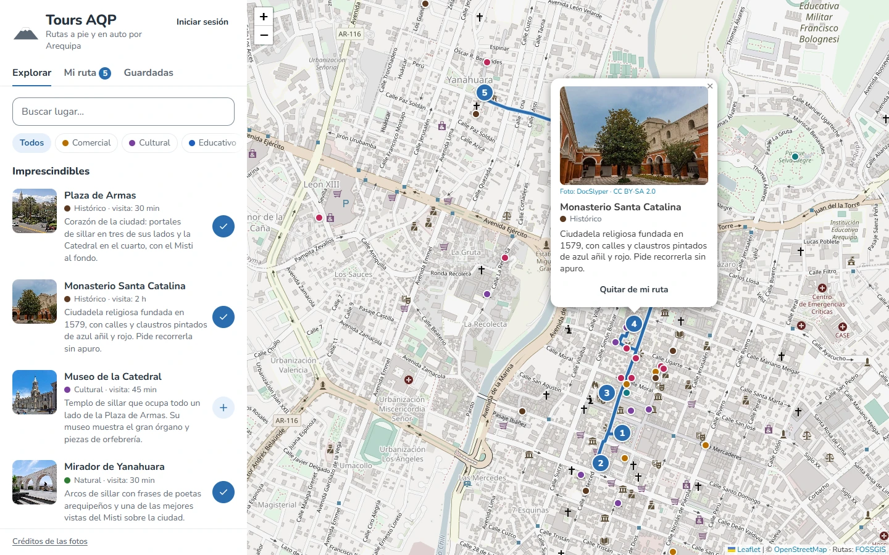
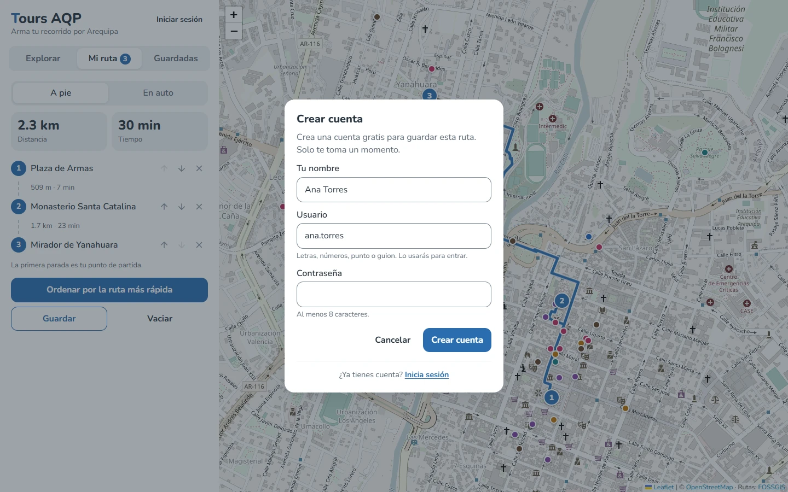
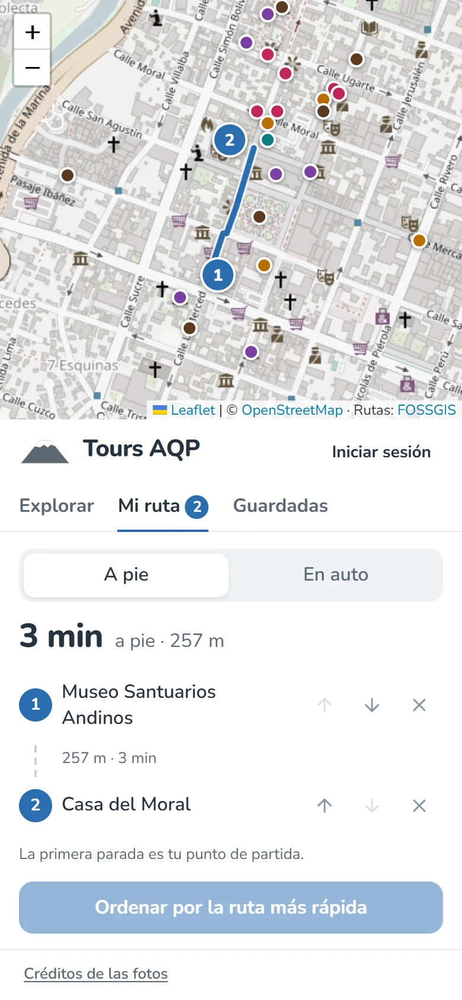
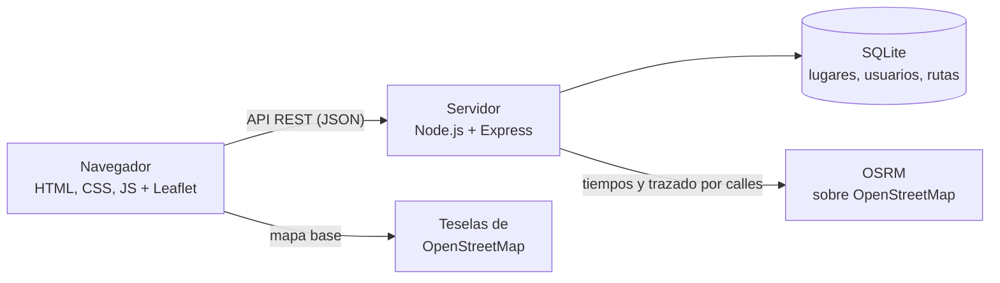

# Tours AQP

**Planificador de recorridos turísticos por Arequipa.** Elige los lugares que quieres visitar y la app traza el camino por las calles reales, a pie o en auto, y ordena las paradas para que tardes lo menos posible.




## Qué hace

- **Explora 55 lugares** de Arequipa en 7 categorías (históricos, culturales, naturales, restaurantes…), con búsqueda al escribir que ignora acentos y filtros por categoría.
- **Arma tu ruta** desde la lista o el mapa. El recorrido sigue las calles reales, con distancia y tiempo total y por cada tramo.
- **A pie o en auto:** el camino y los tiempos cambian según cómo te mueves, incluidos los sentidos únicos de las calles.
- **Ordena por la ruta más rápida:** reorganiza las paradas usando los tiempos reales entre ellas y te dice cuánto tiempo ahorras.
- **Guarda tus rutas** con una cuenta gratuita y vuelve a abrirlas cuando quieras. Cada usuario ve solo las suyas.
- **Funciona en el celular:** el mapa arriba y el panel abajo, pensado para usarse caminando por la ciudad.

## Capturas

| Explorar por categoría | Crear cuenta para guardar |
| --- | --- |
|  |  |

<p align="center">
  
</p>

## Cómo funciona



### Decisiones técnicas

- **Rutas por calles reales.** El servidor consulta [OSRM](https://project-osrm.org/) sobre datos de OpenStreetMap, con perfiles a pie y en auto. Las respuestas se guardan en caché y cada visitante tiene un límite de consultas, para no saturar el servicio público. Si OSRM no responde, la app no se rompe: muestra una estimación en línea recta y lo avisa.
- **Orden de paradas.** Es un problema del viajante abierto: la primera parada queda fija como punto de partida. Uso *vecino más cercano* para una solución inicial y la mejoro con **2-opt** sobre la matriz de tiempos reales de OSRM. Como por calles ir de A a B no siempre cuesta lo mismo que de B a A, el 2-opt recalcula el costo completo de cada candidato.
- **Seguridad.**
  - Contraseñas con PBKDF2-HMAC-SHA256 y sal por usuario.
  - Sesión nueva al iniciar sesión, para evitar la fijación de sesión.
  - Límite de intentos de login y de cuentas nuevas.
  - Validación de todas las entradas y errores en JSON, sin trazas expuestas.
  - Las rutas ajenas responden 404, así no se revela cuáles existen.
- **Accesibilidad (WCAG 2.2 AA).** Verificada con axe:
  - Pestañas que se usan con el teclado y avisos que los lectores de pantalla anuncian.
  - Contraste mínimo de 4.5:1 en texto.
  - Áreas táctiles de al menos 24 px.
  - Respeto a la preferencia de "reducir movimiento" del sistema.
- **Sin dependencias pesadas.** Frontend en JavaScript sin frameworks y base de datos con el módulo nativo `node:sqlite`, así que no hay nada que compilar.

## Ejecutar localmente

Requiere **Node.js 22.5 o superior**.

```bash
cd ToursAQPWeb
npm install
npm start
```

Abre `http://localhost:3000`. Para probar como turista, crea una cuenta desde la app. También hay un usuario de prueba con rol de administrador, que puede editar lugares:

- Usuario: `admin`
- Contraseña: `admin123`

### Pruebas

```bash
cd ToursAQPWeb
npm test
```

Hay 21 pruebas con `node:test` que cubren:
- El cálculo y la optimización de rutas.
- Qué hace la app cuando el servicio de rutas falla.
- El registro, los permisos y la privacidad de las rutas.
- La validación de datos y los límites de intentos.

Usan una copia temporal de la base de datos y un servidor OSRM simulado, así que no dependen de internet.

Más detalles técnicos, como variables de entorno y estructura del código, en [`ToursAQPWeb/README.md`](ToursAQPWeb/README.md).

## Historia del proyecto

| Versión | Tecnología | Origen |
| --- | --- | --- |
| [**v1 y v2**](universidad/) | Escritorio, C++ y Qt | Proyecto de la **Universidad La Salle** (Arequipa) |
| **v3 (actual)** | Web, Node.js | **Desarrollo propio**, por mi cuenta, fuera del curso |

Tours AQP nació en la universidad como una **aplicación de escritorio en C++ con Qt**, centrada en algoritmos de grafos: recorría una red de lugares con DFS, BFS y Dijkstra. Después, por mi cuenta, lo convertí en una aplicación web pensada para un turista de verdad:

1. **De escritorio a web.** Lo migré a Node.js para que se pueda usar desde un enlace en vez de instalar un ejecutable.
2. **Datos reales.** Corregí las coordenadas de los 55 lugares con geocodificación de OpenStreetMap; antes eran aproximaciones alrededor de un solo punto.
3. **Del algoritmo de clase a la utilidad real.** Dejé de lado DFS y BFS, que no sirven para planificar un tour, y reemplacé la distancia en línea recta por rutas y tiempos por calles.
4. **Calidad.** Agregué seguridad, pruebas automáticas, una auditoría de accesibilidad y un rediseño enfocado en que la app sea tranquila de usar en el celular.

Las versiones universitarias se conservan, archivadas, en [`universidad/`](universidad/). El estado exacto en que se entregaron está marcado con la etiqueta [`v1.0-universidad`](https://github.com/Gamb1t0/ToursAQP/tree/v1.0-universidad).

## Estructura del repositorio

```text
ToursAQP/
├── ToursAQPWeb/        # Versión actual (desarrollo propio): Node.js + Express + SQLite + Leaflet
├── universidad/        # Versiones del curso en C++/Qt (archivadas)
│   ├── ToursAQP/       #   v1: primera versión
│   └── ToursAQP2/      #   v2: versión más completa
├── docs/capturas/      # Imágenes de este README
└── LICENSE
```

## Próximos pasos

- Publicar una demo en línea (Render o Fly.io).
- Guardar la ruta en curso al recargar la página y compartirla con un enlace.
- Usar la ubicación del celular como punto de partida.
- Agregar fotos, horarios y precios de cada lugar.
- Verificar en campo las ~16 coordenadas que siguen siendo aproximadas: son negocios pequeños que no están en OpenStreetMap.

## Autor

**Alex Abdon Rhoddo Pacheco**

Proyecto bajo [licencia MIT](LICENSE). Datos del mapa © colaboradores de [OpenStreetMap](https://www.openstreetmap.org/copyright). Rutas calculadas con [OSRM](https://project-osrm.org/) mediante los servidores de [FOSSGIS](https://routing.openstreetmap.de/).
